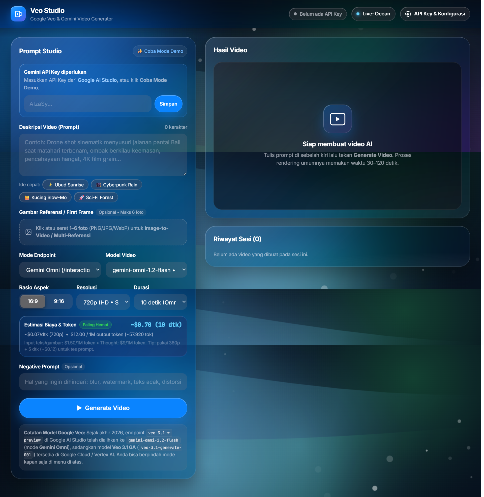

# Veo Studio - Google Veo Video Generator

Website generator video sederhana berbasis HTML, CSS, dan JavaScript murni yang siap dihubungkan ke **Google Veo API** (`:predictLongRunning`) maupun **Gemini Omni Video** (`/v1beta/interactions`).

  
  

## Fitur Utama
- **Text-to-Video & Image-to-Video:** Input prompt, negative prompt, dan unggah gambar referensi (first frame).
- **Kontrol Parameter:** Pilihan model (termasuk Custom Model ID), rasio aspek (`16:9` / `9:16`), resolusi (`720p` / `1080p`), dan durasi.
- **Polling Otomatis Asinkron:** Menampilkan timer, jumlah polling, status operasi, dan tombol batal.
- **Mode Demo Lokal:** Uji alur generate, pemutar video, unduh, dan riwayat sesi tanpa perlu API Key.
- **Backend Proxy Opsional (`server.js`):** Server Node.js tanpa dependensi eksternal agar `GEMINI_API_KEY` tetap aman di sisi server saat deploy.

## Cara Menjalankan

### Opsi 1: Langsung Buka di Browser (Tanpa Install Apa pun)
1. Buka file `index.html` langsung dengan browser (Chrome / Edge / Firefox).
2. Klik **✨ Coba Mode Demo** untuk langsung mencoba tampilan, atau masukkan API Key Anda pada kolom konfigurasi.

### Opsi 2: Menggunakan Backend Proxy (Disarankan untuk Produksi)
Membutuhkan Node.js v18+:
1. Salin `.env.example` menjadi `.env` lalu isi `GEMINI_API_KEY` (dan `GEMINI_API_BASE_URL` jika pakai endpoint kustom) yang didapat dari Google ai studio akun.
2. Jalankan:
   ```bash
   node server.js
   ```
3. Buka `http://localhost:3000` di browser. Frontend akan otomatis mendeteksi proxy `/api` sehingga API Key tidak perlu dimasukkan di browser.

## Catatan Penting Soal Endpoint & Model
- **Google Veo (`:predictLongRunning`):** Mendukung model seperti `veo-3.1-generate-001`, `veo-3.1-fast-generate-001`, atau model kustom sesuai endpoint Anda.
- **Gemini Omni (`/interactions`):** Jika menggunakan API Key standar Google AI Studio (di mana model preview Veo lama telah dialihkan ke `gemini-omni-1.2-flash`), pilih mode **Gemini Omni (/interactions)** di antarmuka web.
- Anda bisa mengganti **Base URL API** melalui tombol **API Key & Konfigurasi** di kanan atas jika menggunakan endpoint Vertex AI, gateway, atau proxy kustom.
